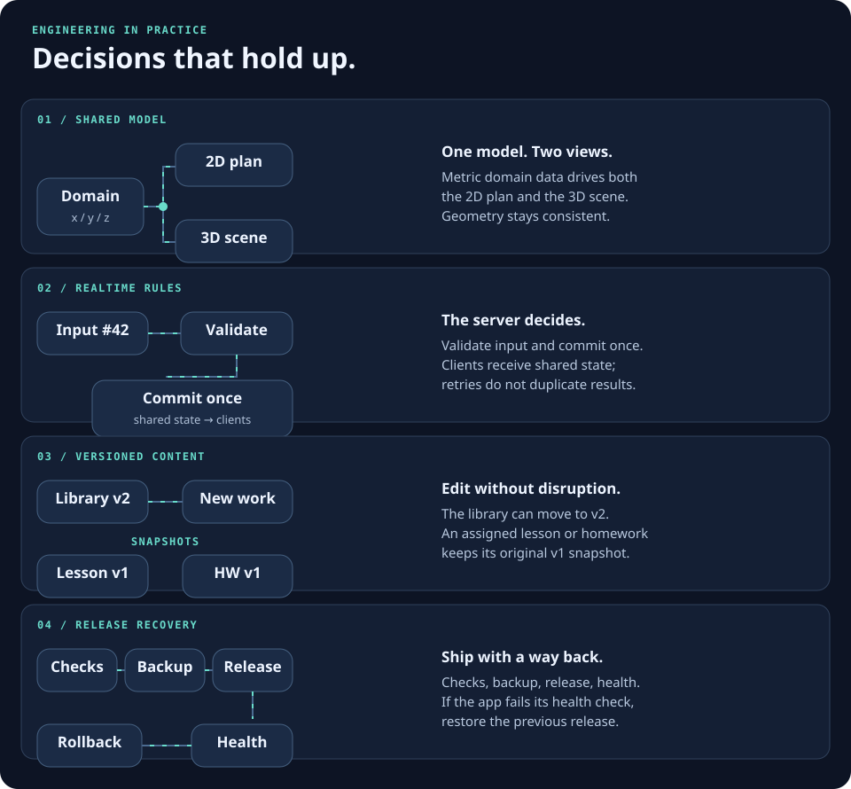

<picture>
  <source media="(max-width: 760px)" srcset="./assets/engineering-pipeline-mobile.svg" />
  
</picture>

I’m a full-stack engineer working with **Go and TypeScript**. I build web products from domain rules and database schemas to interactive interfaces, automated checks and deployment.

[Portfolio](https://baibakovkir.space) · [Public repositories](https://github.com/baibakovkir?tab=repositories) · [Email](mailto:baibakovkir@yandex.ru)

## Selected public projects

| Project | What it does | Engineering focus |
| --- | --- | --- |
| [Countryhouse](https://github.com/baibakovkir/countryhouse-go-next) | Land planning with terrain, structures, utilities, costs and schedules. | Go, PostgreSQL, Next.js, SVG and React Three Fiber; one metric model for 2D and 3D. |
| [Tutor platform](https://github.com/baibakovkir/tutor-platform) | Scheduling, payment tracking, homework and shared learning games, built on an open-source foundation. | Next.js, PostgreSQL, SSE; an editable task library with immutable lesson and homework snapshots. |
| [NINJAS X](https://github.com/baibakovkir/phaser-express-socket) | A multiplayer MOBA prototype with desktop and touch controls. | React, Phaser, Socket.IO, Protobuf, Redis and PostgreSQL; server simulation, prediction and interpolation. |

| [Portfolio](https://github.com/baibakovkir/baibakovkir-space) | Personal website presenting selected work and technical experience. | Next.js, React and Three.js; responsive interfaces and interactive presentation. |

## Engineering decisions

<picture>
  <source media="(max-width: 760px)" srcset="./assets/engineering-decisions-mobile.svg" />
  
</picture>

- **Keep one source of truth.** Domain models drive multiple views; rendering does not redefine the underlying geometry or rules.
- **Make shared state predictable.** Validate actions on the server, handle retries explicitly and restore state after reconnects.
- **Separate editing from ongoing work.** Versioned snapshots let a content library evolve while existing assignments remain stable.
- **Plan for failed releases.** Automated checks, backups, health checks and application rollback are part of delivery. Schema changes need their own compatibility plan.
- **Keep ownership explicit.** Access checks, private files and revocable sessions belong in the application model, alongside the product features.

## Technologies I use

| Area | Tools |
| --- | --- |
| Backend | Go, Node.js, TypeScript, NestJS, REST, OpenAPI |
| Interfaces | React, Next.js, Vue 3, accessible components, responsive layouts |
| Interactive systems | SVG, React Three Fiber, Phaser, WebSockets, Socket.IO, SSE |
| Data | PostgreSQL, Redis, SQL migrations, PGlite, IndexedDB |
| Delivery & quality | Docker, GitHub Actions, Linux, Vitest, Jest, Cypress, Playwright |

I also work on non-public systems. Their names, repositories, clients and implementation details are omitted here; the engineering principles above describe how I approach the work.

## Contact

Open to full-stack and backend-focused engineering opportunities.

[Email](mailto:baibakovkir@yandex.ru) · [Website](https://baibakovkir.space)
