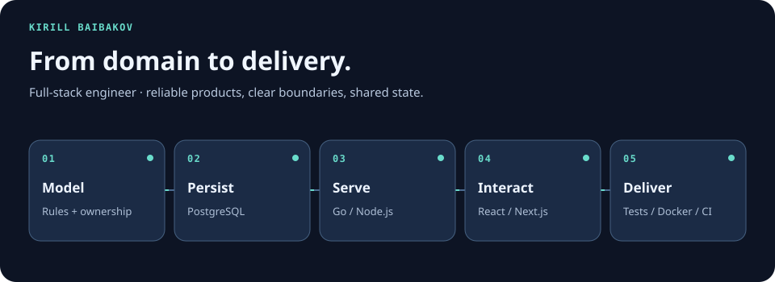

  

I’m a full-stack engineer who turns domain-heavy requirements into maintainable web products—from data modeling and APIs to accessible interfaces and dependable releases.

Currently building **[Countryhouse](https://github.com/baibakovkir/countryhouse-go-next)**, a precise land-planning application with a Go API and synchronized 2D/3D views.

**[Open live demo](https://countryhouse.baibakovkir.space)** · **[Explore the source](https://github.com/baibakovkir/countryhouse-go-next)** · **[Email me](mailto:baibakovkir@yandex.ru)**

## What I bring

- Full-stack ownership, from domain modeling and API design to UI and deployment
- Clean Architecture and pragmatic, maintainable service boundaries
- Backend development with Go and TypeScript
- Responsive interfaces and accessible component systems
- PostgreSQL data modeling and versioned SQL migrations
- Docker-based delivery and GitHub Actions CI/CD
- Automated testing, observability-minded delivery, and rollback-safe releases

## Featured work — Countryhouse

Planning a real property means keeping precise geometry, terrain, structures, utilities, costs, and work schedules consistent. Countryhouse brings those concerns into one responsive application.

I own the product across the stack: domain modeling, Go REST API, PostgreSQL schema, Next.js interface, visualization, testing, and production delivery.

### Engineering highlights

- One metric source of truth drives both SVG-based 2D plans and React Three Fiber 3D scenes.
- Simplified Clean Architecture keeps domain rules independent from storage and HTTP transport.
- Flexible polygon, polyline, elevation, and utility models avoid a rigid element catalog.
- Automated checks, database backups, health checks, and rollback make containerized releases safer.

**[Try Countryhouse](https://countryhouse.baibakovkir.space)** · **[Read the code](https://github.com/baibakovkir/countryhouse-go-next)**

## Selected production work

Some of my production work lives in private company repositories. These public products show the kind of systems I have delivered:

- **[Import substitution proposals · Aggregator of Trade](https://agregatoreat.ru)** — implemented the import-substitution proposals section for a public procurement platform.
- **[Gossort RF](https://gossortrf.ru)** — owned the full-stack implementation of the public website.

## Core stack

- **Backend:** Go, Node.js, NestJS, REST, OpenAPI, WebSockets
- **Frontend:** TypeScript, React, Next.js, Vue 3, React Three Fiber
- **Data & delivery:** PostgreSQL, Redis, Docker, GitHub Actions, Linux
- **Quality:** Vitest, Jest, Cypress, versioned SQL migrations, Clean Architecture

## Contact

Open to full-stack and backend-focused engineering opportunities.

[Email](mailto:baibakovkir@yandex.ru) · [WebSite](https://baibakovkir.space)
